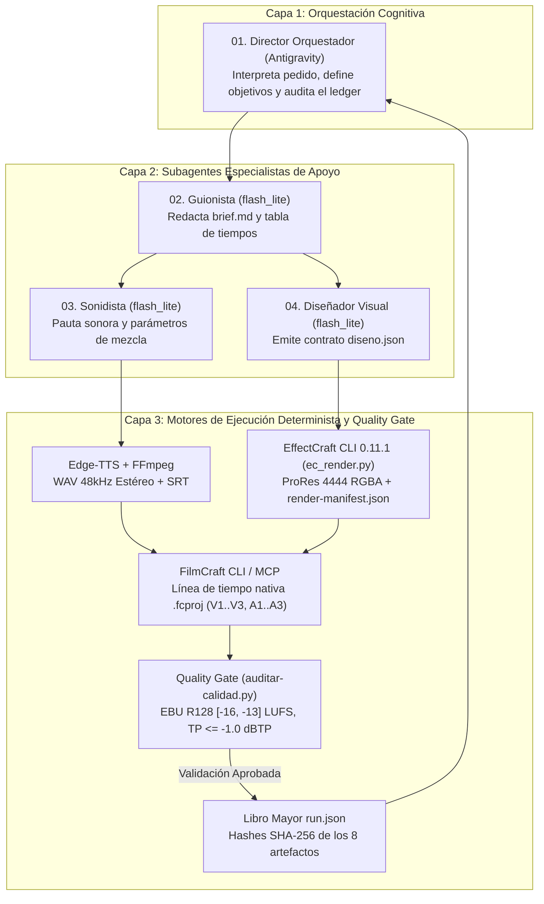

# 🎬 EditorVideo: Sistema de Producción de Video Automatizado con Suite Craft + Google Antigravity

[](https://opensource.org/licenses/MIT)
[](https://filmcraft.app)
[](https://filmcraft.app)
[](https://github.com/storytold/photocraft)
[](https://github.com/storytold/soundcraft)
[-00B894.svg)](#arquitectura-híbrida-verificable-3-capas)
[](#quality-gate-estricto-ebu-r128)
[](#requisitos-y-configuración)

Sistema profesional y 100% de código abierto para la **planificación, generación de medios, motion graphics, edición no lineal multitrack, masterización de audio y control de calidad criptográfico de video**. 

A diferencia de simulaciones puramente conversacionales, **EditorVideo** implementa una **Arquitectura Híbrida Verificable**: combina el razonamiento estratégico de **Google Antigravity** y subagentes especializados con la solidez determinista de la suite **ArtCraft (FilmCraft CLI, EffectCraft CLI, PhotoCraft CLI, SoundCraft CLI)**, **FFmpeg** y un **Quality Gate con bloqueo estricto** que valida sonoridad EBU R128 y registra hashes SHA-256 inmutables de cada artefacto en `05_logs/run.json`.

Todo se ejecuta **localmente en una sola PC**, sin costos recurrentes por API, con resolución dinámica de rutas y listo para clonarse y verificarse en cualquier máquina Windows.

---

## 🚀 Características Principales

- ⚡ **Arquitectura Híbrida Verificable:** Orquestación cognitiva con contratos formales (`diseno.json`, `render-manifest.json`, `thumbnail-manifest.json`, `run.json`) y ejecución determinista por CLI.
- 🎨 **Integración Nativa con EffectCraft CLI 0.11.1:** Renderizado de plantillas de movimiento (`.ectemplate`) en **Apple ProRes 4444 RGBA** con canal alfa verificado (`yuva444p12le`) y fotogramas transparentes PNG.
- 🖼️ **Diseño de Miniaturas con PhotoCraft CLI 0.16.0:** Generación automatizada de portadas y miniaturas de alto CTR para YouTube/Shorts/TikTok con tipografías de cine y manifiesto SHA-256.
- 🎚️ **Masterización de Audio con SoundCraft CLI 0.13.1:** Análisis espectral, remuestreo determinista a 48000 Hz estéreo y normalización profesional de stems.
- 🎛️ **Líneas de Tiempo Multitrack Reales en FilmCraft:** Montaje no lineal programático (`V1`, `V2`, `V3`, `A1`, `A2`, `A3`) en proyectos nativos `.fcproj` vía comandos de lote (`command_batch`) o FilmCraft CLI headless.
- 🛡️ **Quality Gate Estricto EBU R128:** El exportador y el pipeline exigen sonoridad integrada en `[-16.0, -13.0] LUFS` y pico verdadero $\le -1.0$ dBTP; cualquier desviación o clipping aborta con `exit 1`.
- 🔐 **Auditoría Criptográfica Inmutable (`run.json`):** Cada ejecución registra los SHA-256, tamaños de archivo y fecha de modificación de cada activo (brief, locución, SRT, manifest de EffectCraft, miniatura PhotoCraft, timeline `.fcproj`, collage QA y video master).
- 🎙️ **Locución Neural y Subtítulos Sincronizados:** Voces ultra-realistas con Microsoft Edge-TTS convertidas automáticamente a **WAV 48 kHz estéreo** con exportación de archivos `.srt`.
- ✂️ **Recorte Inteligente de Silencios:** Limpieza automática de pausas y tiempos muertos en videos crudos utilizando `auto-editor`.
- 🔍 **Auditoría Visual en Cuadrícula 2x2:** El Auditor QA analiza 4 fotogramas clave deterministas en una sola imagen combinada generada en 0.02s (`collage_qc.png`).
- 🎶 **Biblioteca Compartida Preinstalada (98+ Activos Libres):** Música lofi, pads documentales, temas virales, efectos de sonido de cine, grabaciones culturales de Cusco y Chumbivilcas (*Wakawaqra*, *Pututu*, *Huaylía*, *Takanakuy*), viñetas y pantallas verdes con licencias catalogadas en `LICENSES.json` y `CREDITS.md`.

---

## 👥 Arquitectura Híbrida Verificable (3 Capas)

El sistema reemplaza las falsas narrativas de "agentes totalmente autónomos" por una arquitectura de ingeniería robusta en 3 capas donde **ningún agente puede afirmar que algo está listo sin un artefacto verificado en disco**:



### Contratos Formales entre Capas

1. **Guionista ➔ Sonidista / Diseñador:** `00_brief/brief.md` con sección obligatoria `## Guion` y tiempos por escena.
2. **Diseñador ➔ EffectCraft Engine:** Contrato JSON formal `diseno.json` con `template`, `values`, `comp`, `format` (`prores`/`png`), `channels` (`rgba`), `fps` y `output`.
3. **EffectCraft Engine ➔ Montajista:** Asset renderizado (`overlay.mov` o `.png`) con su correspondiente `render-manifest.json` que valida dimensiones, fps y canal alfa.
4. **Montajista ➔ FilmCraft Engine:** Montaje en pistas multitrack y persistencia física de `slug_vNN.fcproj`.
5. **Quality Gate ➔ Orquestador:** Control estricto de audio y video. Si no existe el `.fcproj`, si el render no tiene manifest verificado o si la sonoridad sale de `[-16, -13]` LUFS, se genera **Hard Fail (`exit 1`)** y se aborta el export.

---

## 🧪 Suite de Pruebas de Integridad (5 Pruebas Automatizadas)

Para comprobar de forma inmediata e indiscutible que el sistema no depende de rutas locales y que los Quality Gates funcionan de verdad, el repositorio incluye un banco de pruebas automatizado:

```powershell
powershell -ExecutionPolicy Bypass -File .\HERRAMIENTAS\test-pipeline-suite.ps1
```

### Resultados de la Suite

| # | Prueba | Tipo | Criterio de Aprobación | Resultado |
| :---: | :--- | :--- | :--- | :---: |
| **1** | **Pipeline Completo End-to-End** | Positiva (Happy Path) | Monta `.fcproj` nativo en FilmCraft, renderiza overlay ProRes 4444 RGBA con EffectCraft 0.11.1, pasa Quality Gate EBU R128 y genera `run.json` con 8 artefactos verificados. | **PASADO (0)** |
| **2** | **Sonoridad Débil (-25 LUFS)** | Negativa | El Quality Gate detecta audio fuera de `[-16, -13] LUFS` y aborta inmediatamente con `exit 1`. | **PASADO (1)** |
| **3** | **Clipping y True Peak Excedido** | Negativa | El Quality Gate detecta pico superior a `-1.0 dBTP` (+2.1 dBTP) y bloquea el export con `exit 1`. | **PASADO (1)** |
| **4** | **Línea de Tiempo `.fcproj` Inexistente** | Negativa | El pipeline exige un archivo `.fcproj` real y rechaza pipelines simulados con `exit 1`. | **PASADO (1)** |
| **5** | **Diseño EffectCraft sin Manifiesto** | Negativa | El pipeline detecta un asset de diseño sin su `render-manifest.json` verificado y bloquea con `exit 1`. | **PASADO (1)** |

---

## 📁 Estructura del Repositorio

```text
editor-filmcraft-con-antigravity/
├── README.md                          # Documentación maestra del repositorio
├── AGENTS.md                          # Instrucciones y directivas para agentes de IA
├── COMO_PEDIR_UN_VIDEO.md             # Guía rápida para encargar videos con 1 prompt
├── PROMPTS.md                         # Colección de prompts por fases de producción
├── LICENSE                            # Licencia MIT
├── .gitignore                         # Exclusión de temporales y renders pesados (>100MB)
├── .gitattributes                     # Normalización de saltos de línea y binarios
├── .agents/                           # Configuración de agentes y servidores MCP
│   ├── 01_director.md                 # Prompt de orquestación
│   ├── 02_guionista.md                # Prompt del guionista
│   ├── 03_sonidista.md                # Prompt del sonidista
│   ├── 04_disenador_visual.md         # Prompt del diseñador visual
│   ├── 05_montajista.md               # Prompt del montajista (sintaxis FilmCraft batch)
│   ├── 06_auditor_qa.md               # Prompt del auditor visual
│   ├── mcp_config.json                # Declaración del puente MCP de FilmCraft (:8765)
│   └── agents/                        # Definiciones persistentes de subagentes
├── HERRAMIENTAS/                      # Scripts de automatización local (PowerShell / Python)
│   ├── abrir-filmcraft.ps1            # Inicia FilmCraft con el puerto MCP :8765 habilitado
│   ├── nuevo-proyecto.ps1             # Crea la estructura aislada de un proyecto nuevo
│   ├── generar-voz.ps1                # Genera voz neural WAV 48kHz con subtítulos .srt
│   ├── recortar-silencios.ps1         # Limpieza de silencios con auto-editor
│   ├── importar-recurso.ps1           # Copia selectiva con filtrado (-Filtro "nombre")
│   ├── crear-collage-qa.py            # Ensambla cuadrícula 2x2 en 0.02s para el Auditor
│   └── resumir-timeline.ps1           # Consulta en vivo FilmCraft y resume pistas e IDs
├── RECURSOS_COMPARTIDOS/              # Biblioteca libre preinstalada (98+ activos listos)
│   ├── 01_musica/                     # Lofi, Documental, Acústica + memes_y_virales/
│   ├── 02_efectos_sonido/             # SFX cine + cultural_cusco_chumbivilcas/ + memes_y_virales/
│   ├── 03_animaciones_y_graficos/     # Viñetas, marcos REC, pantalla_verde/ y stickers
│   └── 04_licencias_y_fuentes/        # Fuentes Bebas Neue, Anton, Montserrat, Inter + guía
├── _PLANTILLA/                        # Plantilla de carpetas para nuevos proyectos
├── CREDITS.md                         # Atribuciones legales obligatorias (CC-BY Kevin MacLeod, CC0)
└── PROYECTOS/                         # Videos producidos organizados por fecha y slug
    ├── 2026-10-23_prueba-estructura/
    ├── 2026-10-23_tecnologia-chumbivilcas/
    ├── 2026-10-24_cultura-60s/
    ├── 2026-10-24_tecnologia/
    ├── 2026-10-24_cumbia-sombras-3m/
    └── 2026-10-24_mediflow-demo/
```

---

## 🛠️ Herramientas Locales de Automatización

Todos los scripts se encuentran en la carpeta [`HERRAMIENTAS/`](HERRAMIENTAS/):

| Script | Lenguaje | Descripción | Ejemplo de Uso |
| :--- | :--- | :--- | :--- |
| `setup-entorno.ps1` | PowerShell | Resuelve rutas dinámicas, autodescubre FilmCraft y EffectCraft 0.11.1, genera `mcp_config.json`. | `.\HERRAMIENTAS\setup-entorno.ps1` |
| `test-pipeline-suite.ps1` | PowerShell | Suite de 5 pruebas de integridad (Happy Path + 4 pruebas negativas de fallo con bloqueo). | `.\HERRAMIENTAS\test-pipeline-suite.ps1` |
| `ejecutar-pipeline.ps1` | PowerShell | Orquestador determinista: compila assets, monta, audita y firma el `run.json` criptográfico. | `.\HERRAMIENTAS\ejecutar-pipeline.ps1 -Proyecto "PROYECTOS\test-golden-10s"` |
| `effectcraft/ec_render.py` | Python (CLI) | Motor EffectCraft: valida `diseno.json`, renderiza ProRes 4444 RGBA / PNG y emite `render-manifest.json`. | `python .\HERRAMIENTAS\effectcraft\ec_render.py "diseno.json"` |
| `effectcraft/validar-render.ps1` | PowerShell | Valida soporte ProRes alfa, fotogramas transparentes y 3 pruebas negativas de EffectCraft. | `.\HERRAMIENTAS\effectcraft\validar-render.ps1` |
| `auditar-calidad.py` | Python (FFmpeg) | Quality Gate estricto: valida EBU R128 (`[-16, -13]` LUFS, True Peak <= -1.0 dBTP, `exit 1` si falla). | `python .\HERRAMIENTAS\auditar-calidad.py "ruta\video.mp4"` |
| `remediar-audio.py` | Python (FFmpeg) | Remasteriza y normaliza el audio a -14 LUFS y True Peak <= -1.0 dBTP en 2 pases (mitiga ISP en AAC). | `python .\HERRAMIENTAS\remediar-audio.py "ruta\video.mp4"` |
| `generar-voz.ps1` | PowerShell | Extrae el guion con regex flexible, genera TTS con Edge-TTS, `.srt` y WAV 48kHz estéreo. | `.\HERRAMIENTAS\generar-voz.ps1 -Proyecto "cultura-60s" -NombreSalida "locucion"` |
| `abrir-filmcraft.ps1` | PowerShell | Lanza FilmCraft con `--control 8765`, ordenando por versión `_vNN` y cierre seguro no destructivo. | `.\HERRAMIENTAS\abrir-filmcraft.ps1 -Proyecto "mediflow"` |
| `nuevo-proyecto.ps1` | PowerShell | Crea la estructura (`00_brief` a `05_logs`) con su `brief.md` base y sección `## Guion`. | `.\HERRAMIENTAS\nuevo-proyecto.ps1 -Nombre "Historia Andina" -Formato vertical_720` |
| `crear-collage-qa.py` | Python (PIL) | Genera `04_previews/collage_qc.png` usando fotogramas deterministas (`qa_01` a `qa_04`). | `python .\HERRAMIENTAS\crear-collage-qa.py "cultura-60s"` |
| `recortar-silencios.ps1` | PowerShell | Usa `auto-editor` para eliminar pausas vacías de videos crudos. | `.\HERRAMIENTAS\recortar-silencios.ps1 -Video "entrada.mp4" -Salida "recortado.mp4"` |
| `importar-recurso.ps1` | PowerShell | Copia recursos de la biblioteca compartida a `01_fuentes/` con filtro por nombre. | `.\HERRAMIENTAS\importar-recurso.ps1 -Proyecto "..." -Tipo cultural -Filtro "*wakawaqra*"` |
| `resumir-timeline.ps1` | PowerShell | Lee el estado en memoria o disco de FilmCraft y devuelve resumen compacto sin gastar tokens. | `.\HERRAMIENTAS\resumir-timeline.ps1 -Proyecto "mediflow"` |


---

## 🎼 Biblioteca de Medios Compartida (`RECURSOS_COMPARTIDOS/`)

La carpeta [`RECURSOS_COMPARTIDOS/`](RECURSOS_COMPARTIDOS/) contiene activos libres de derechos optimizados en formato y frecuencia de muestreo (WAV 48 kHz / MP3 estéreo / PNG transparente):

- **Música General y Virales:**
  - Pistas temáticas: Lofi Chill, Ambient Documentary, Acoustic Warmth, Techno Fast, Chiptune 8-bit.
  - Memes Virales: *Pedro Pedro Pedro* (Mapache), *Toca Toca*, *Coffin Dance* (Astronomía), *GigaChad* (Can You Feel My Heart), *Roundabout* (To Be Continued), *Careless Whisper*, tracks clásicos de comedia de Kevin MacLeod (*Monkeys Spinning Monkeys*, *Sneaky Snitch*, *Fluffing a Duck*, *Scheming Weasel*, *Elevator Music*).
- **Efectos de Sonido (SFX):**
  - Cinematográficos: Whoosh rápido/pesado/cinemático, impactos graves, risers de tensión, pops, disparador de cámara.
  - Memes: *Vine Boom*, *Record Scratch*, *Sad Trombone* (Fail), *Grillos* (silencio incómodo), *Dun Dun Dun*, *Cartoon Boing*, *Slap* (cachetada), *Bruh*, campana de boxeo.
- **Identidad Cultural Cusco / Chumbivilcas / Santo Tomás:**
  - Grabaciones auténticas: *Wakawaqra* (toque tradicional, llamada corta, diana corrida, remate Takanakuy, eco andino de montaña), *Pututu* ceremonial inca, *Chillador* (rasgueo huaylía chumbivilcana), *Tinya* (bombo andino), *Cascabeles y espuelas de Qorilazo*, *Charango* tradicional, comparsa carnavalesca y locución quechua.
- **Gráficos, Overlays y Pantallas Verdes:**
  - Viñetas cinematográficas (vertical 720 / horizontal 720), marcos de cámara estilo `REC`, barras cinemascope, lentes *Thug Life*, flechas y bocadillos de cómic.
  - Animaciones de pantalla verde en MP4: explosión y botón de suscripción.
- **Fuentes Tipográficas:**
  - `Bebas Neue`, `Anton`, `Montserrat` e `Inter` (formatos TTF y variables).

---

## 📐 Formatos de Video Soportados

| Clave | Plataforma Principal | Resolución | Aspecto | FPS | Audio |
| :--- | :--- | :--- | :--- | :--- | :--- |
| **`vertical_1080`** | TikTok, Instagram Reels, YouTube Shorts (HQ) | `1080x1920` | `9:16` | `30` | `48000 Hz` estéreo |
| **`vertical_720`** | TikTok, Reels, Shorts (modo rápido / ligero) | `720x1280` | `9:16` | `30` | `48000 Hz` estéreo |
| **`horizontal_1080`** | YouTube, tutoriales, clases Full HD | `1920x1080` | `16:9` | `30` | `48000 Hz` estéreo |
| **`horizontal_720`** | Borradores rápidos o videos ligeros | `1280x720` | `16:9` | `30` | `48000 Hz` estéreo |
| **`cuadrado_1080`** | Posts de Instagram / feed cuadrado | `1080x1080` | `1:1` | `30` | `48000 Hz` estéreo |
| **`cine_1080_24`** | Estilo documental / cinematográfico | `1920x1080` | `16:9` | `24` | `48000 Hz` estéreo |

---

## ⚡ Guía de Inicio Rápido

### 1. Requisitos Previos
- **Sistema Operativo:** Windows 10/11 x64.
- **Python:** 3.10+ con librerías: `pip install edge-tts auto-editor Pillow numpy yt-dlp faster-whisper`
- **FFmpeg:** Instalado en el `PATH` del sistema.
- **FilmCraft:** Versión 0.9.0 o superior (binario `filmcraft-cli.exe`).
- **EffectCraft:** Versión 0.11.1 o superior (binario `effectcraft-cli.exe` para Motion Graphics y ProRes RGBA).
- **Google Antigravity:** IDE o Antigravity 2.0 Desktop.

### 2. Clonar el Repositorio y Configurar Entorno
```bash
git clone https://github.com/vilammarx6-droid/editor-filmcraft-con-antigravity.git
cd editor-filmcraft-con-antigravity
```
Inicializa automáticamente las rutas y el puente MCP dinámico:
```powershell
powershell -ExecutionPolicy Bypass -File .\HERRAMIENTAS\setup-entorno.ps1
```

### 3. Ejecutar la Suite de Pruebas de Integridad
Verifica que el entorno, los binarios CLI y los Quality Gates respondan al 100%:
```powershell
powershell -ExecutionPolicy Bypass -File .\HERRAMIENTAS\test-pipeline-suite.ps1
```

### 4. Crear un Nuevo Proyecto de Video
En PowerShell:
```powershell
.\HERRAMIENTAS\nuevo-proyecto.ps1 -Nombre "Mi Primer Video" -Formato vertical_720
```

### 5. Abrir FilmCraft con el Puente MCP
```powershell
.\HERRAMIENTAS\abrir-filmcraft.ps1 -Proyecto "PROYECTOS\2026-10-24_mi-primer-video"
```
*Deja la ventana de FilmCraft abierta: el puerto `8765` escuchará las órdenes de Antigravity.*

### 6. Encargar el Video a Antigravity
Abre la carpeta en **Google Antigravity** y escribe un prompt como:
> *"Director, revisa `PROYECTOS/2026-10-24_mi-primer-video/00_brief/brief.md`. Lanza al Guionista, Sonidista y Diseñador, monta el timeline en FilmCraft, valida los manifiestos de EffectCraft y audita el Quality Gate."*

---

## 📡 Protocolo y Servidores MCP (FilmCraft + EffectCraft)

Antigravity se comunica con las herramientas de producción mediante servidores de contexto Model Context Protocol (MCP) generados dinámicamente por `setup-entorno.ps1` desde `.agents/mcp_config.template.json`:

```json
{
  "mcpServers": {
    "filmcraft": {
      "command": "C:\\ruta\\a\\filmcraft-cli.exe",
      "args": ["--bridge", "127.0.0.1:8765", "mcp"]
    },
    "effectcraft": {
      "command": "C:\\ruta\\a\\effectcraft-cli.exe",
      "args": [
        "mcp",
        "--autosave",
        "--automation-read-root", "C:\\ruta\\al\\repo",
        "--automation-write-root", "C:\\ruta\\al\\repo"
      ]
    }
  }
}
```

### Despacho de Lotes (`command_batch`)
Para evitar la latencia de enviar órdenes una por una, el Montajista despacha las modificaciones en un solo array:
```json
[
  {"id": "timeline.place", "params": {"items": [12, 13, 14], "track": "V1", "seconds": 0.0}},
  {"id": "timeline.place", "params": {"item": 22, "track": "A1", "seconds": 0.0}},
  {"id": "timeline.place", "params": {"item": 23, "track": "A2", "seconds": 0.0}},
  {"id": "timeline.setTrack", "params": {"track": "A2", "volumeDb": -18.0}},
  {"id": "file.save", "params": {"path": "C:/proyectos/slug_v01.fcproj"}}
]
```

---

## 🔒 Reglas de Seguridad y Buenas Prácticas

1. **Protección de Fuentes Originales:** Los archivos dentro de `01_fuentes/` nunca se borran ni se sobreescriben.
2. **Versionado Obligatorio:** Toda iteración o cambio genera una nueva versión (`_v01.fcproj`, `_v02.fcproj`).
3. **Protección de Exportaciones:** Las exportaciones en `03_exports/` llevan sufijo de versión y formato (`slug_v01_vertical_720.mp4`).
4. **Inspección Compacta:** Está estrictamente prohibido volcar árboles JSON gigantes en el chat; se utiliza [`resumir-timeline.ps1`](HERRAMIENTAS/resumir-timeline.ps1) para ahorrar tokens y mantener la agilidad del modelo.

---

## 📄 Licencia

Este proyecto está bajo la Licencia [MIT](LICENSE). Eres libre de usarlo, modificarlo y distribuirlo para proyectos personales o comerciales.
