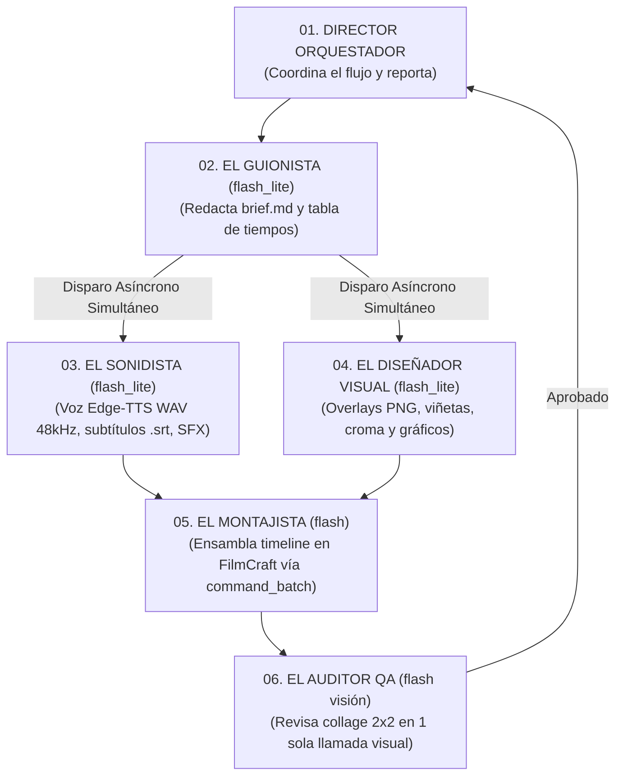

# 🎬 EditorVideo: Sistema de Producción de Video Automatizado con FilmCraft + Google Antigravity

[](https://opensource.org/licenses/MIT)
[](https://filmcraft.app)
[](#arquitectura-del-equipo-de-6-agentes)
[](#herramientas-locales-de-automatización)
[](#requisitos-y-configuración)

Sistema profesional y 100% de código abierto para la **planificación, generación de medios, edición no lineal y control de calidad de video** operado por un equipo de **6 agentes de IA especializados** que controlan el editor de escritorio **FilmCraft** mediante el protocolo **MCP (Model Context Protocol)**.

Todo se ejecuta **localmente en una sola PC**, sin suscripciones mensuales de servicios externos, optimizado para una latencia mínima y un ahorro del **80% al 95% en consumo de tokens**.

---

## 🚀 Características Principales

- ⚡ **Arquitectura Asíncrona en Paralelo:** El Sonidista y el Diseñador Visual se ejecutan simultáneamente, reduciendo los tiempos de espera a la mitad.
- 🎛️ **Control en Vivo de FilmCraft (MCP `:8765`):** Manipulación directa del timeline, colocación de clips en pistas de video y audio, niveles de decibeles y cortes precisos en tiempo real.
- 📦 **Despacho Masivo (`command_batch`):** Todas las órdenes de montaje se calculan en memoria y se envían en un único lote, evitando llamadas secuenciales innecesarias.
- 🎙️ **Locución Neural y Subtítulos Sincronizados:** Voces ultra-realistas con Microsoft Edge-TTS convertidas automáticamente a **WAV 48 kHz estéreo** con exportación de archivos `.srt`.
- ✂️ **Recorte Inteligente de Silencios:** Limpieza automática de pausas y tiempos muertos en videos crudos utilizando `auto-editor`.
- 🔍 **Auditoría Visual en Cuadrícula 2x2:** El Auditor QA analiza hasta 4 capturas clave del video en una sola imagen combinada generada en 0.02s (`collage_qc.png`), eliminando cuellos de botella en la inspección visual.
- 🎶 **Biblioteca Compartida Preinstalada (98+ Activos):** Música lofi, pads documentales, temas virales/memes, efectos de sonido cinematográficos, **grabaciones culturales autóctonas de Cusco y Chumbivilcas (Wakawaqra, Pututu, Huaylía, Takanakuy)**, overlays transparentes, marcos REC y pantallas verdes.

---

## 👥 Arquitectura del Equipo de 6 Agentes

El flujo está diseñado para maximizar la velocidad mediante la **selección quirúrgica de modelos** (modelos ultraligeros `flash_lite` para tareas mecánicas) y **respuestas en JSON estricto sin saludos ni textos de relleno**:



### Roles y Responsabilidades

| Agente | Modelo | Entrada | Salida | Función Principal |
| :--- | :--- | :--- | :--- | :--- |
| **01. Director** | Heredado | Pedido del usuario | Video final listo | Orquesta el pipeline, valida dependencias y gestiona el relevo de agentes. |
| **02. Guionista** | `flash_lite` | Brief inicial | `00_brief/brief.md` | Redacta el guion, define el gancho de los primeros 3s y la tabla de escenas. |
| **03. Sonidista** | `flash_lite` | Guion de audio | `01_fuentes/audio/` | Genera voz neural WAV 48kHz, subtítulos `.srt` e importa música/SFX. |
| **04. Diseñador** | `flash_lite` | Tabla visual | `01_fuentes/graficos/` | Prepara viñetas, marcos de cámara, stickers y videos croma. |
| **05. Montajista** | `flash` | Archivos de fuentes | `.fcproj` guardado | Coloca clips, pistas `V1/V2/A1/A2/A3`, niveles de volumen y cortes en 1 lote. |
| **06. Auditor QA** | `flash` (visión) | `collage_qc.png` | Reporte JSON de QA | Inspecciona encuadres, legibilidad de textos y coherencia de planos. |

---

## 📁 Estructura del Repositorio

```text
editor-filmcraft-con-antigravity/
├── README.md                          # Documentación maestra del repositorio
├── AGENTS.md                          # Instrucciones y directivas para agentes de IA
├── COMO_PEDIR_UN_VIDEO.md             # Guía rápida para encargar videos con 1 prompt
├── PROMPTS.md                         # Colección de prompts por fases de producción
├── LICENSE                            # Licencia MIT
├── .gitignore                         # Exclusión de temporales y renders pesados (>100MB)
├── .gitattributes                     # Normalización de saltos de línea y binarios
├── .agents/                           # Configuración de agentes y servidores MCP
│   ├── 01_director.md                 # Prompt de orquestación
│   ├── 02_guionista.md                # Prompt del guionista
│   ├── 03_sonidista.md                # Prompt del sonidista
│   ├── 04_disenador_visual.md         # Prompt del diseñador visual
│   ├── 05_montajista.md               # Prompt del montajista (sintaxis FilmCraft batch)
│   ├── 06_auditor_qa.md               # Prompt del auditor visual
│   ├── mcp_config.json                # Declaración del puente MCP de FilmCraft (:8765)
│   └── agents/                        # Definiciones persistentes de subagentes
├── HERRAMIENTAS/                      # Scripts de automatización local (PowerShell / Python)
│   ├── abrir-filmcraft.ps1            # Inicia FilmCraft con el puerto MCP :8765 habilitado
│   ├── nuevo-proyecto.ps1             # Crea la estructura aislada de un proyecto nuevo
│   ├── generar-voz.ps1                # Genera voz neural WAV 48kHz con subtítulos .srt
│   ├── recortar-silencios.ps1         # Limpieza de silencios con auto-editor
│   ├── importar-recurso.ps1           # Copia selectiva con filtrado (-Filtro "nombre")
│   ├── crear-collage-qa.py            # Ensambla cuadrícula 2x2 en 0.02s para el Auditor
│   └── resumir-timeline.ps1           # Consulta en vivo FilmCraft y resume pistas e IDs
├── RECURSOS_COMPARTIDOS/              # Biblioteca libre preinstalada (98+ activos listos)
│   ├── 01_musica/                     # Lofi, Documental, Acústica + memes_y_virales/
│   ├── 02_efectos_sonido/             # SFX cine + cultural_cusco_chumbivilcas/ + memes_y_virales/
│   ├── 03_animaciones_y_graficos/     # Viñetas, marcos REC, pantalla_verde/ y stickers
│   └── 04_licencias_y_fuentes/        # Fuentes Bebas Neue, Anton, Montserrat, Inter + guía
├── _PLANTILLA/                        # Plantilla de carpetas para nuevos proyectos
└── PROYECTOS/                         # Videos producidos organizados por fecha y slug
    ├── 2026-10-23_prueba-estructura/
    ├── 2026-10-23_tecnologia-chumbivilcas/
    ├── 2026-10-24_cultura-60s/
    ├── 2026-10-24_tecnologia/
    └── 2026-10-24_cumbia-sombras-3m/
```

---

## 🛠️ Herramientas Locales de Automatización

Todos los scripts se encuentran en la carpeta [`HERRAMIENTAS/`](HERRAMIENTAS/):

| Script | Lenguaje | Descripción | Ejemplo de Uso |
| :--- | :--- | :--- | :--- |
| `abrir-filmcraft.ps1` | PowerShell | Lanza FilmCraft con `--control 8765` para permitir la conexión en vivo del MCP. | `.\HERRAMIENTAS\abrir-filmcraft.ps1 -Proyecto "PROYECTOS\2026-10-24_cultura-60s"` |
| `nuevo-proyecto.ps1` | PowerShell | Crea la estructura de carpetas (`00_brief` a `05_notas`) con su `brief.md` base. | `.\HERRAMIENTAS\nuevo-proyecto.ps1 -Nombre "Historia Andina" -Formato vertical_720` |
| `generar-voz.ps1` | PowerShell | Sintetiza voz neural con `edge-tts`, genera `.srt` y convierte a WAV 48kHz estéreo. | `.\HERRAMIENTAS\generar-voz.ps1 -Texto "Hola mundo" -Voz "es-PE-AlexNeural" -Salida "audio.wav"` |
| `recortar-silencios.ps1` | PowerShell | Usa `auto-editor` para eliminar pausas vacías de videos crudos. | `.\HERRAMIENTAS\recortar-silencios.ps1 -Video "entrada.mp4" -Salida "recortado.mp4"` |
| `importar-recurso.ps1` | PowerShell | Copia recursos de la biblioteca compartida a `01_fuentes/` con filtro por nombre. | `.\HERRAMIENTAS\importar-recurso.ps1 -Proyecto "..." -Tipo cultural -Filtro "*wakawaqra*"` |
| `crear-collage-qa.py` | Python (PIL) | Genera `04_previews/collage_qc.png` uniendo 4 capturas en cuadrícula en 0.02s. | `python .\HERRAMIENTAS\crear-collage-qa.py "PROYECTOS\2026-10-24_cultura-60s"` |
| `resumir-timeline.ps1` | PowerShell | Lee el estado en memoria de FilmCraft y devuelve un resumen compacto con IDs de clip. | `.\HERRAMIENTAS\resumir-timeline.ps1 -Proyecto "PROYECTOS\2026-10-24_cultura-60s"` |

---

## 🎼 Biblioteca de Medios Compartida (`RECURSOS_COMPARTIDOS/`)

La carpeta [`RECURSOS_COMPARTIDOS/`](RECURSOS_COMPARTIDOS/) contiene activos libres de derechos optimizados en formato y frecuencia de muestreo (WAV 48 kHz / MP3 estéreo / PNG transparente):

- **Música General y Virales:**
  - Pistas temáticas: Lofi Chill, Ambient Documentary, Acoustic Warmth, Techno Fast, Chiptune 8-bit.
  - Memes Virales: *Pedro Pedro Pedro* (Mapache), *Toca Toca*, *Coffin Dance* (Astronomía), *GigaChad* (Can You Feel My Heart), *Roundabout* (To Be Continued), *Careless Whisper*, tracks clásicos de comedia de Kevin MacLeod (*Monkeys Spinning Monkeys*, *Sneaky Snitch*, *Fluffing a Duck*, *Scheming Weasel*, *Elevator Music*).
- **Efectos de Sonido (SFX):**
  - Cinematográficos: Whoosh rápido/pesado/cinemático, impactos graves, risers de tensión, pops, disparador de cámara.
  - Memes: *Vine Boom*, *Record Scratch*, *Sad Trombone* (Fail), *Grillos* (silencio incómodo), *Dun Dun Dun*, *Cartoon Boing*, *Slap* (cachetada), *Bruh*, campana de boxeo.
- **Identidad Cultural Cusco / Chumbivilcas / Santo Tomás:**
  - Grabaciones auténticas: *Wakawaqra* (toque tradicional, llamada corta, diana corrida, remate Takanakuy, eco andino de montaña), *Pututu* ceremonial inca, *Chillador* (rasgueo huaylía chumbivilcana), *Tinya* (bombo andino), *Cascabeles y espuelas de Qorilazo*, *Charango* tradicional, comparsa carnavalesca y locución quechua.
- **Gráficos, Overlays y Pantallas Verdes:**
  - Viñetas cinematográficas (vertical 720 / horizontal 720), marcos de cámara estilo `REC`, barras cinemascope, lentes *Thug Life*, flechas y bocadillos de cómic.
  - Animaciones de pantalla verde en MP4: explosión y botón de suscripción.
- **Fuentes Tipográficas:**
  - `Bebas Neue`, `Anton`, `Montserrat` e `Inter` (formatos TTF y variables).

---

## 📐 Formatos de Video Soportados

| Clave | Plataforma Principal | Resolución | Aspecto | FPS | Audio |
| :--- | :--- | :--- | :--- | :--- | :--- |
| **`vertical_1080`** | TikTok, Instagram Reels, YouTube Shorts (HQ) | `1080x1920` | `9:16` | `30` | `48000 Hz` estéreo |
| **`vertical_720`** | TikTok, Reels, Shorts (modo rápido / ligero) | `720x1280` | `9:16` | `30` | `48000 Hz` estéreo |
| **`horizontal_1080`** | YouTube, tutoriales, clases Full HD | `1920x1080` | `16:9` | `30` | `48000 Hz` estéreo |
| **`horizontal_720`** | Borradores rápidos o videos ligeros | `1280x720` | `16:9` | `30` | `48000 Hz` estéreo |
| **`cuadrado_1080`** | Posts de Instagram / feed cuadrado | `1080x1080` | `1:1` | `30` | `48000 Hz` estéreo |
| **`cine_1080_24`** | Estilo documental / cinematográfico | `1920x1080` | `16:9` | `24` | `48000 Hz` estéreo |

---

## ⚡ Guía de Inicio Rápido

### 1. Requisitos Previos
- **Sistema Operativo:** Windows 10/11 x64.
- **Python:** 3.10+ con librerías: `pip install edge-tts auto-editor Pillow numpy yt-dlp faster-whisper`
- **FFmpeg:** Instalado en el `PATH` del sistema.
- **FilmCraft:** Versión 0.9.0 o superior (disponible con `filmcraft-cli.exe`).
- **Google Antigravity:** IDE o Antigravity 2.0 Desktop.

### 2. Clonar el Repositorio
```bash
git clone https://github.com/vilammarx6-droid/editor-filmcraft-con-antigravity.git
cd editor-filmcraft-con-antigravity
```

### 3. Crear un Nuevo Proyecto de Video
En PowerShell:
```powershell
.\HERRAMIENTAS\nuevo-proyecto.ps1 -Nombre "Mi Primer Video" -Formato vertical_720
```

### 4. Abrir FilmCraft con el Puente MCP
```powershell
.\HERRAMIENTAS\abrir-filmcraft.ps1 -Proyecto "PROYECTOS\2026-10-24_mi-primer-video"
```
*Deja la ventana de FilmCraft abierta: el puerto `8765` escuchará las órdenes de Antigravity.*

### 5. Encargar el Video a Antigravity
Abre la carpeta en **Google Antigravity** y escribe un prompt como:
> *"Director, revisa `PROYECTOS/2026-10-24_mi-primer-video/00_brief/brief.md`. Lanza al Guionista, Sonidista y Diseñador en paralelo, monta el timeline en FilmCraft y genera la auditoría QA."*

---

## 📡 Protocolo y Puente FilmCraft MCP

El servidor MCP conecta Antigravity con FilmCraft mediante el socket local `127.0.0.1:8765`. 

### Configuración en `.agents/mcp_config.json`
```json
{
  "mcpServers": {
    "filmcraft": {
      "command": "C:\\ruta\\a\\filmcraft-cli.exe",
      "args": ["--bridge", "127.0.0.1:8765", "mcp"]
    }
  }
}
```

### Despacho de Lotes (`command_batch`)
Para evitar la latencia de enviar órdenes una por una, el Montajista despacha las modificaciones en un solo array:
```json
[
  {"id": "timeline.place", "params": {"items": [12, 13, 14], "track": "V1", "seconds": 0.0}},
  {"id": "timeline.place", "params": {"item": 22, "track": "A1", "seconds": 0.0}},
  {"id": "timeline.place", "params": {"item": 23, "track": "A2", "seconds": 0.0}},
  {"id": "timeline.setTrack", "params": {"track": "A2", "volumeDb": -18.0}},
  {"id": "file.save", "params": {"path": "C:/proyectos/slug_v01.fcproj"}}
]
```

---

## 🔒 Reglas de Seguridad y Buenas Prácticas

1. **Protección de Fuentes Originales:** Los archivos dentro de `01_fuentes/` nunca se borran ni se sobreescriben.
2. **Versionado Obligatorio:** Toda iteración o cambio genera una nueva versión (`_v01.fcproj`, `_v02.fcproj`).
3. **Protección de Exportaciones:** Las exportaciones en `03_exports/` llevan sufijo de versión y formato (`slug_v01_vertical_720.mp4`).
4. **Inspección Compacta:** Está estrictamente prohibido volcar árboles JSON gigantes en el chat; se utiliza [`resumir-timeline.ps1`](HERRAMIENTAS/resumir-timeline.ps1) para ahorrar tokens y mantener la agilidad del modelo.

---

## 📄 Licencia

Este proyecto está bajo la Licencia [MIT](LICENSE). Eres libre de usarlo, modificarlo y distribuirlo para proyectos personales o comerciales.
